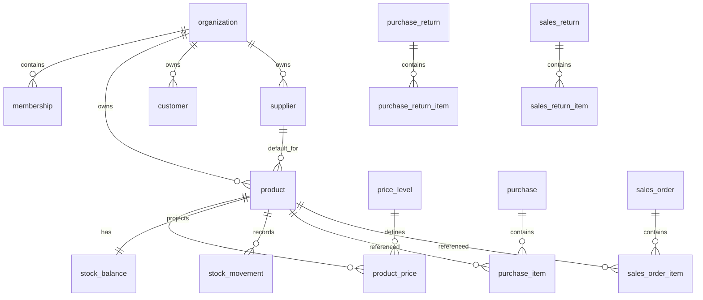

# 磨小二进销存系统数据模型

## 1. 设计原则与命名

表名使用 `snake_case` 复数；主键建议 UUID；时间以 UTC `timestamptz` 保存。业务表包含 `created_at`、`updated_at`，审计对象另含创建/更新或操作用户。金额使用 `numeric`，后端 `Decimal`；精度待确认。已引用资料使用 `is_active` 停用，不使用物理删除。

## 2. 实体关系总览

`organization` 是 boss 数据边界，owner 是 boss 用户；employee 经 `membership` 加入唯一组织。商品、伙伴、价格、单据和库存记录都必须关联组织。库存余额由流水投影，不单独成为审计来源。

## 3. 核心实体

| 表 | 所属模块 | 核心字段 | 约束/说明 |
| --- | --- | --- | --- |
| `users` | accounts | `id`, `username`, `password`, `display_name`, `is_active` | 基于 Django 认证用户扩展；用户名唯一策略待确认。 |
| `organizations` | accounts | `id`, `owner_user_id`, `name`, 审计字段 | `owner_user_id` 唯一，注册 boss 时创建。 |
| `memberships` | accounts | `id`, `organization_id`, `user_id`, `role`, `is_active` | employee 唯一归属一个组织；`role` 为 `BOSS` 或 `EMPLOYEE`。 |
| `permission_grants` | accounts | `membership_id`, `permission_code`, `granted_by`, `granted_at` | employee 获批权限；与会员、权限码唯一。 |
| `permission_requests` | accounts | `membership_id`, `permission_code`, `status`, `reviewed_by`, `reviewed_at` | 申请、批准或拒绝审计。 |
| `shop_profiles` | accounts | `organization_id`, 待确认的店铺字段 | 一对一；字段由 RQ-03 确认。 |
| `product_categories` | products | `organization_id`, `name`, `is_active` | 主文档未明确分类；若首期页面不需要则不实现。 |
| `units` | products | `organization_id`, `name`, `is_active` | 组织内名称唯一。 |
| `specifications` | products | `organization_id`, `name`, `is_active` | 规格定义；需确认颜色是否同一模型。 |
| `product_attributes` | products | `organization_id`, `name`, `input_type`, `is_active` | `input_type`：`TEXT`、`SELECT`。 |
| `attribute_options` | products | `attribute_id`, `value`, `is_active` | 仅选择型属性可有选项。 |
| `products` | products | `organization_id`, `name`, `unit_id`, `supplier_id`, `is_active`, 审计字段 | `supplier_id` 为可选默认供应商，必须属于同组织；不保存可编辑库存。 |
| `product_spec_values` | products | `product_id`, `specification_id`, `value` | 商品使用的规格值。 |
| `product_attribute_values` | products | `product_id`, `attribute_id`, `text_value`/`option_id` | 按属性类型二选一并 Check。 |
| `price_levels` | partners | `organization_id`, `name`, `sort_order`, `is_active` | 默认零售价、批发价；每组织有效记录最多六个须在服务层保证。 |
| `product_prices` | products | `product_id`, `price_level_id`, `amount` | `(product_id, price_level_id)` 唯一；`amount >= 0`。 |
| `customers` | partners | `organization_id`, `name`, `contact_name`, `phone`, `remark`, `is_active` | 名称创建必填；组织内按名称、联系人、电话组合唯一，允许同名和多条不同联系方式。 |
| `suppliers` | partners | `organization_id`, `name`, `contact_name`, `contact_address`, `phone`, `remark`, `is_active` | 名称创建必填；组织内按名称、联系人、联系地址、电话组合唯一，允许同名。 |
| `purchases`/`purchase_items` | purchases | 组织、编号、供应商、状态、完成审计；商品、数量、单价、行金额 | 单据金额由明细计算；候选状态见 DOC-001。 |
| `purchase_returns`/`purchase_return_items` | purchases | 与采购等价结构 | 原单关联待 RQ-07。 |
| `products` | products | 组织、名称、单位、`purchase_price`、启停与审计 | `purchase_price >= 0`；进货价用于后续完成销售/销售退货的成本快照。 |
| `sales_orders`/`sales_order_items` | sales | 组织、编号、客户、`DRAFT/COMPLETED` 状态、完成审计；商品、数量、单价、行金额、单位成本快照、成本金额 | 销售完成禁止负库存；完成时锁定商品进货价，草稿可编辑，完成后只读。销售价格等级快照或选择规则待 RQ-05。 |
| `sales_returns`/`sales_return_items` | sales | 与销售等价结构，含单位成本快照和成本金额 | 完成后增加库存并冲减销售额与成本；成本使用完成时进货价，原单关联待 RQ-07。 |
| `stock_balances` | inventory | `organization_id`, `product_id`, `quantity`, `updated_at` | `(organization_id, product_id)` 唯一；派生查询投影。 |
| `stock_movements` | inventory | 组织、商品、`quantity_delta`、`movement_type`、来源类型/ID、操作人、发生时间 | 只追加；`movement_type` 为 `INITIAL`、`PURCHASE`、`PURCHASE_RETURN`、`SALE`、`SALE_RETURN`。 |

单据明细保存商品名称、单位、销售单价、完成时单位成本及成本金额快照，避免基础资料后续改名或改价影响历史统计。

## 4. 外键、约束与索引

- 所有组织业务表以 `organization_id` 外键关联 `organizations`，使用 `PROTECT`；业务服务始终从认证用户推导组织。
- 商品、客户、供应商、单位、规格、价格等级被单据引用时使用 `PROTECT`，通过 `is_active=false` 停用。
- 客户唯一索引为 `(organization_id, Trim(name), Trim(contact_name), Trim(phone))`；供应商另包含 `Trim(contact_address)`，停用记录也参与唯一性检查。空字符串是有效比较值，联系字段不允许 SQL NULL；旧名称唯一限制由 `partners.0006_partner_identity_unique` 替换。迁移仅检查现有记录并调整约束，不更新、合并、删除或规范化已有业务数据。
- 单据明细删除随草稿单据级联；完成后不得经普通 ORM/API 删除（DOC-001）。
- `stock_movements` 对 `(organization_id, product_id, occurred_at)` 建索引用于账本查询；对 `(source_type, source_id)` 建索引用于追溯。
- `stock_balances` 的唯一索引同时支撑锁定更新和快速库存查询。
- 每种单据对 `(organization_id, document_no)` 建唯一索引；新单据使用类型前缀加北京时间 `YYYYMMDDHHmmss`，同秒重号从 `-02` 起追加序号（DOC-005~007）。沿用现有 64 字符字段及唯一约束，不新增表或迁移历史数据。
- 所有高频列表表按 `(organization_id, created_at DESC)` 建索引；状态筛选可使用 `(organization_id, status, created_at DESC)`。
- 数量必须大于零，库存流水的正负号必须与来源类型一致；以 Check 约束和服务校验双重保护。

## 5. 不可变、敏感与派生数据

库存流水、已完成单据的明细/状态审计字段不可通过客户端修改。`stock_balances.quantity`、单据行金额、总额、完成人、完成时间和统计值由后端计算。密码哈希、JWT 配置与任何联系信息为敏感数据，序列化时最小化暴露。

## 6. 待确认事项

- 类别是否为首期功能、商品/客户/供应商/店铺的字段、用户名唯一范围（RQ-03）。
- 状态、作废和反审核正式枚举，单据编号格式（RQ-01）。
- 数量/金额精度、税额、折扣（RQ-04）；成本核算升级路径（RQ-06）。
- 退货原单关联、初始库存更正和负库存策略（RQ-02、RQ-07）。