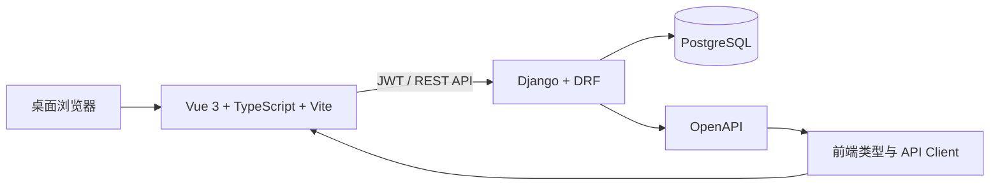

# GrindBuddy（磨小二）项目介绍

GrindBuddy 是面向小型零售与批发团队的进销存 Web 项目，优先服务于单台电脑上的日常经营：从商品建档、采购入库到销售出库、退货和库存查询，把业务单据与库存变化串联起来。项目采用前后端分离架构，目标是让库存有据可查、业务数据按店铺隔离，并为后续部署到局域网保留空间。

> 本文用于 GitHub 项目介绍。功能范围以当前代码和[需求规格](requirements.md)为准；部署前请先完成环境配置、安全检查和实际业务验收。

## 项目面向谁

- **店铺老板（boss）**：管理自己的商品、客户、供应商、员工和经营数据。
- **店铺员工（employee）**：在所属老板的数据空间内处理获授权的业务；权限由老板授予或审批。
- **开发与维护者**：依据领域规则、API 契约和验收用例继续开发、部署与维护。

## 核心业务

| 领域 | 项目提供的能力 |
| --- | --- |
| 账号与权限 | 老板注册与登录、员工账号、功能授权及权限申请；后端按所属组织限制数据访问。 |
| 基础资料 | 商品、规格、单位、属性、价格等级、客户与供应商资料维护。 |
| 采购与销售 | 采购单、销售单及对应退货单的录入与受控完成。 |
| 库存 | 商品初始库存、库存余额和流水查询；业务动作完成时产生对应库存变化。 |
| 经营分析 | 首页概览及销售、采购、库存报表。 |

典型使用路径是：**注册老板账号 → 建立商品和往来资料 → 创建采购或销售单 → 完成单据 → 查看库存流水与经营报表**。草稿与已完成单据的操作边界、退货规则和统计口径，请以[领域规则](domain-rules.md)和[验收用例](acceptance.md)为准。

首期聚焦桌面浏览器中的日常进销存。仓库管理、盘点、调拨、库存预警、批次/序列号、财务总账、线上商城和移动端**不属于首期承诺功能**；目录中有预留模块不代表这些能力已经可用。

## 技术架构



- **前端**：Vue 3、TypeScript、Vite、Element Plus、Pinia、Axios 和 TanStack Query for Vue。
- **后端**：Python、Django、Django REST Framework、SimpleJWT 与 drf-spectacular。
- **数据与部署**：PostgreSQL；开发机可原生运行，运行机使用 Docker Compose 编排。
- **质量保障**：后端使用 pytest、pytest-django 和 Ruff；API 类型从 OpenAPI 生成。

库存变更由后端受控动作处理，余额与流水在数据库事务内保持一致；金额使用 `Decimal`/`numeric`，而不是浮点数。组织隔离与权限校验在后端执行，前端的入口控制只用于改善操作体验。设计依据见[系统设计](system-design.md)和[数据模型](data-model.md)。

## 获取与运行

从仓库根目录开始。首次开发前，按[项目 README](../README.md)配置 `backend/.env`、`frontend/.env` 及本机 PostgreSQL；不要将本地密码或密钥提交到 GitHub。开发环境需要 Python、uv、Node.js、npm 和 PostgreSQL，版本基线见[环境说明](../ENVIRONMENT_BASELINE.md)。

```bash
python run.py
```

该命令会执行后端迁移并启动 Django 与 Vite；开发页面默认为 `http://127.0.0.1:5173`。如需在运行机上使用 Docker Compose，请先阅读[部署指南](deployment.md)，按指南配置根目录的 `.env`，再执行：

```bash
docker compose up --build -d
```

运行机默认通过 `http://<运行机地址>:8080` 访问；端口与访问范围取决于部署配置。真实业务数据上线前应做好数据库备份、恢复演练和访问控制。

## 代码与文档导航

| 位置 | 说明 |
| --- | --- |
| [`backend/`](../backend/) | Django 应用、业务服务、API 和后端测试。 |
| [`frontend/`](../frontend/) | Vue 页面、路由、状态和 API 调用。 |
| [`infra/`](../infra/) | Nginx 配置及运维脚本。 |
| [API 规范](api.md) | 接口契约、状态动作与错误格式。 |
| [界面规格](ui.md) | 页面与交互设计。 |
| [验收用例](acceptance.md) | 业务行为及回归验证清单。 |
| [完整目录说明](../DIRECTORY_STRUCTURE.md) | 项目结构和文件放置约定。 |

项目仍以需求与领域规则作为开发基线。贡献功能或修复问题时，请先阅读关联规格，补齐相应测试，并同步更新受影响的文档；尤其不要绕过库存流水、事务、权限或审计规则。更多开发与验证命令见[项目 README](../README.md)。