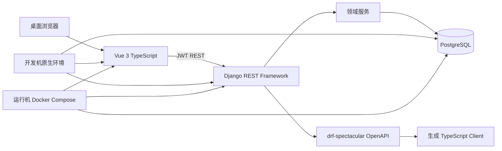
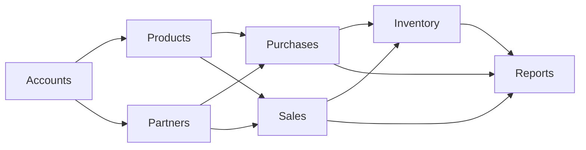

# 磨小二进销存系统最终系统设计说明书

## 1. 目的、范围与状态

本文汇编 [功能模块设计.docx](功能模块设计.docx)、[需求规格](requirements.md)、[领域规则](domain-rules.md)、[数据模型](data-model.md)、[API 规范](api.md)、[界面规格](ui.md) 和[验收测试](acceptance.md)，作为实现基线。已确认首期为 boss/employee、资料与价格、购销及退货、库存查询、销售/进货/库存统计和店铺设置。仓库、盘点、调拨、预警、批次、序列号、保质期、移动端、财务和短信登录为范围外或后续预留。

首期单据状态为 `DRAFT -> COMPLETED`，完成后不可编辑或删除；作废和反审核不实现。销售完成禁止负库存。数量使用 `numeric(18,4)`，金额使用 `numeric(18,2)` 并按四舍五入计算。商品维护两位小数进货价，销售与销售退货完成时锁定单位成本快照，并以净销售额减净销售成本计算毛利。

## 2. 架构设计



采用单体 Django 后端与独立 Vue 前端。accounts 管理身份、组织和权限；products/partners 管理资料；purchases/sales 维护单据；inventory 独占余额和流水写入；reports 只读聚合。View、Serializer 和前端不得直接改库存。所有组织业务数据以当前身份推导的 boss 组织过滤。开发机原生运行 Python、Node.js 和 `D:\PostgreSQL` 中的 PostgreSQL，不安装 Docker；运行机通过 Docker Compose 使用与开发机一致的固定版本基础镜像构建和运行服务，具体版本见根目录 [ENVIRONMENT_BASELINE.md](../ENVIRONMENT_BASELINE.md)。

## 3. 业务与概念设计



`organization` 是 boss 租户边界：注册 boss 创建组织；employee 通过 membership 唯一归属组织。商品带单位、规格、属性及分级价格；单据包含可审计的明细快照；库存流水为事实账本，余额为受事务维护的查询投影。详见 [数据模型](data-model.md)。

## 4. 逻辑表设计

### 4.1 设计约定

- 以下逻辑表是首期的唯一持久化边界。实际项目使用 Django migration 生成、执行及版本管理；第 5 节 SQL 是用于评审和校验的 PostgreSQL 参考 DDL，不应绕过 migration 直接在生产库执行。
- 除 `accounts_user` 外，所有业务表均以 `organization_id` 实现 boss 租户隔离。服务层从当前用户推导组织，客户端无权指定组织。
- 主键采用 UUID；`created_at`、`updated_at` 使用 UTC `timestamptz`。金额、单价用 `numeric(18,2)`，数量用 `numeric(18,4)`；后续精度变更只能通过迁移统一调整。
- 已被引用的基础资料不物理删除，使用 `is_active` 停用。库存余额为流水投影，库存流水只追加不更新、不删除。

### 4.2 账号、组织与权限

| 逻辑表 | 物理表 | 主键/租户 | 核心业务属性 | 关系、不可变属性与规则 |
| --- | --- | --- | --- | --- |
| 用户 | `accounts_user` | `id`；无 | `username`、密码哈希、显示名、启用状态 | Django 自定义用户表；`username` 全局唯一，注册只产生 boss。 |
| 组织 | `accounts_organization` | `id`；自身即租户 | `owner_user_id`、`name` | 一个 boss 用户唯一拥有一个组织；组织归属不可由客户端修改。 |
| 组织成员 | `accounts_membership` | `id`、`organization_id` | `user_id`、`role`、启用状态 | employee 的 `user_id` 唯一，保证仅归属一个 boss；boss 也有一条 `BOSS` 成员记录。 |
| 权限授予 | `accounts_permission_grant` | `id`，经 membership 间接租户 | `permission_code`、授予人/时间 | `(membership_id, permission_code)` 唯一；默认权限在鉴权服务中计算，不重复存储。 |
| 权限申请 | `accounts_permission_request` | `id`，经 membership 间接租户 | 权限码、申请/审批状态、审批人/时间 | 状态为 `PENDING`、`APPROVED`、`REJECTED`；审批完成后不可再次审批。 |
| 店铺资料 | `accounts_shop_profile` | `id`、`organization_id` | `shop_name`、`remark` | 与组织一对一；电话、地址等字段待 RQ-03 确认后添加。 |

### 4.3 商品与价格

| 逻辑表 | 物理表 | 主键/租户 | 核心业务属性 | 关系、不可变属性与规则 |
| --- | --- | --- | --- | --- |
| 单位 | `products_unit` | `id`、`organization_id` | 名称、启用状态 | 组织内名称唯一；被商品引用时仅可停用。 |
| 规格 | `products_specification` | `id`、`organization_id` | 名称、启用状态 | 初始创建尺码、颜色；商品使用其具体值。 |
| 商品属性 | `products_attribute` | `id`、`organization_id` | 名称、输入类型、启用状态 | 输入类型为 `TEXT` 或 `SELECT`。 |
| 属性选项 | `products_attribute_option` | `id`，经属性间接租户 | 值、启用状态 | 仅供 `SELECT` 属性使用。 |
| 商品 | `products_product` | `id`、`organization_id` | 名称、单位、可选默认供应商、启用状态 | 默认供应商必须属于同组织且仅用于资料维护，不替代采购单供应商；无可编辑库存字段；建档初始数量须写 `inventory_stock_movement`。 |
| 商品规格值 | `products_product_spec_value` | `id`，经商品间接租户 | 规格、文本值 | `(product_id, specification_id)` 唯一。 |
| 商品属性值 | `products_product_attribute_value` | `id`，经商品间接租户 | 属性、文本值或选项 | 两种值只能存在其一；由属性类型在服务层校验。 |
| 价格等级 | `partners_price_level` | `id`、`organization_id` | 名称、排序、启用状态 | 默认零售价、批发价；有效等级至多六个，由服务层串行校验。 |
| 商品价格 | `products_product_price` | `id`，经商品间接租户 | 商品、价格等级、单价 | `(product_id, price_level_id)` 唯一；金额不得为负。 |

### 4.4 伙伴、单据与库存

| 逻辑表 | 物理表 | 主键/租户 | 核心业务属性 | 关系、不可变属性与规则 |
| --- | --- | --- | --- | --- |
| 客户/供应商 | `partners_customer`、`partners_supplier` | `id`、`organization_id` | 名称、联系人、电话、备注、启用状态 | 供应商额外保存联系人地址；被单据引用后不可删除。 |
| 采购/采购明细 | `purchases_purchase`、`purchases_purchase_item` | `id`、`organization_id` | 编号、供应商、状态、业务日期、完成审计；商品快照、数量、单价、行金额 | 草稿可编辑；完成后不可编辑。行金额、总额由后端计算。 |
| 采购退货/明细 | `purchases_purchase_return`、`purchases_purchase_return_item` | 同上 | 与采购结构一致 | 原采购单关联字段待 RQ-07；完成后减少库存。 |
| 销售/销售明细 | `sales_sales_order`、`sales_sales_order_item` | 同上 | 编号、客户、状态、业务日期、完成审计；商品快照、数量、单价、行金额 | 完成后减少库存并纳入销售统计。 |
| 销售退货/明细 | `sales_sales_return`、`sales_sales_return_item` | 同上 | 与销售结构一致 | 原销售单关联字段待 RQ-07；完成后增加库存并冲减销售。 |
| 库存余额 | `inventory_stock_balance` | `id`、`organization_id` | 商品、数量、更新时间 | `(organization_id, product_id)` 唯一；只由库存服务更新。 |
| 库存流水 | `inventory_stock_movement` | `id`、`organization_id` | 商品、变动类型、变动数量、来源、发生时间、操作人 | 只追加；正负号必须符合类型；是库存权威审计来源。 |
| 幂等动作 | `inventory_idempotency_record` | `id`、`organization_id` | 业务动作、幂等键、资源/响应引用 | `(organization_id, action, idempotency_key)` 唯一，防止完成动作重放。 |

## 5. 数据库表结构设计（PostgreSQL 参考 DDL）

### 5.1 适用说明

本节为与第 4 节一一对应的建表 SQL。Django 实现中应把约束映射到 `Meta.constraints`、`Meta.indexes` 和 migration；`updated_at` 由应用层或 Django 自动维护。SQL 采用 `gen_random_uuid()`，因此目标数据库须启用 `pgcrypto`。Django 的 `django_migrations`、认证权限、会话等框架表由 Django 自身 migration 管理，不在此重复定义。

```sql
CREATE EXTENSION IF NOT EXISTS pgcrypto;

CREATE TABLE accounts_user (
  id uuid PRIMARY KEY DEFAULT gen_random_uuid(),
  username varchar(150) NOT NULL UNIQUE,
  password varchar(128) NOT NULL,
  display_name varchar(150) NOT NULL DEFAULT '',
  is_active boolean NOT NULL DEFAULT true,
  last_login timestamptz NULL,
  created_at timestamptz NOT NULL DEFAULT now(),
  updated_at timestamptz NOT NULL DEFAULT now()
);

CREATE TABLE accounts_organization (
  id uuid PRIMARY KEY DEFAULT gen_random_uuid(),
  owner_user_id uuid NOT NULL UNIQUE REFERENCES accounts_user(id) ON DELETE RESTRICT,
  name varchar(150) NOT NULL,
  created_at timestamptz NOT NULL DEFAULT now(),
  updated_at timestamptz NOT NULL DEFAULT now()
);

CREATE TABLE accounts_membership (
  id uuid PRIMARY KEY DEFAULT gen_random_uuid(),
  organization_id uuid NOT NULL REFERENCES accounts_organization(id) ON DELETE RESTRICT,
  user_id uuid NOT NULL UNIQUE REFERENCES accounts_user(id) ON DELETE RESTRICT,
  role varchar(16) NOT NULL CHECK (role IN ('BOSS', 'EMPLOYEE')),
  is_active boolean NOT NULL DEFAULT true,
  created_at timestamptz NOT NULL DEFAULT now(),
  updated_at timestamptz NOT NULL DEFAULT now(),
  UNIQUE (organization_id, user_id)
);

CREATE TABLE accounts_permission_grant (
  id uuid PRIMARY KEY DEFAULT gen_random_uuid(),
  membership_id uuid NOT NULL REFERENCES accounts_membership(id) ON DELETE RESTRICT,
  permission_code varchar(100) NOT NULL,
  granted_by_user_id uuid NOT NULL REFERENCES accounts_user(id) ON DELETE RESTRICT,
  granted_at timestamptz NOT NULL DEFAULT now(),
  UNIQUE (membership_id, permission_code)
);

CREATE TABLE accounts_permission_request (
  id uuid PRIMARY KEY DEFAULT gen_random_uuid(),
  membership_id uuid NOT NULL REFERENCES accounts_membership(id) ON DELETE RESTRICT,
  permission_code varchar(100) NOT NULL,
  status varchar(16) NOT NULL DEFAULT 'PENDING'
    CHECK (status IN ('PENDING', 'APPROVED', 'REJECTED')),
  reviewed_by_user_id uuid NULL REFERENCES accounts_user(id) ON DELETE RESTRICT,
  reviewed_at timestamptz NULL,
  created_at timestamptz NOT NULL DEFAULT now(),
  updated_at timestamptz NOT NULL DEFAULT now(),
  CHECK ((status = 'PENDING' AND reviewed_by_user_id IS NULL AND reviewed_at IS NULL)
    OR (status IN ('APPROVED', 'REJECTED') AND reviewed_by_user_id IS NOT NULL AND reviewed_at IS NOT NULL))
);

CREATE TABLE accounts_shop_profile (
  id uuid PRIMARY KEY DEFAULT gen_random_uuid(),
  organization_id uuid NOT NULL UNIQUE REFERENCES accounts_organization(id) ON DELETE RESTRICT,
  shop_name varchar(150) NOT NULL,
  remark text NOT NULL DEFAULT '',
  created_at timestamptz NOT NULL DEFAULT now(),
  updated_at timestamptz NOT NULL DEFAULT now()
);

CREATE TABLE products_unit (
  id uuid PRIMARY KEY DEFAULT gen_random_uuid(),
  organization_id uuid NOT NULL REFERENCES accounts_organization(id) ON DELETE RESTRICT,
  name varchar(50) NOT NULL,
  is_active boolean NOT NULL DEFAULT true,
  created_at timestamptz NOT NULL DEFAULT now(), updated_at timestamptz NOT NULL DEFAULT now(),
  UNIQUE (organization_id, name)
);

CREATE TABLE products_specification (
  id uuid PRIMARY KEY DEFAULT gen_random_uuid(),
  organization_id uuid NOT NULL REFERENCES accounts_organization(id) ON DELETE RESTRICT,
  name varchar(50) NOT NULL,
  is_active boolean NOT NULL DEFAULT true,
  created_at timestamptz NOT NULL DEFAULT now(), updated_at timestamptz NOT NULL DEFAULT now(),
  UNIQUE (organization_id, name)
);

CREATE TABLE products_attribute (
  id uuid PRIMARY KEY DEFAULT gen_random_uuid(),
  organization_id uuid NOT NULL REFERENCES accounts_organization(id) ON DELETE RESTRICT,
  name varchar(50) NOT NULL,
  input_type varchar(16) NOT NULL CHECK (input_type IN ('TEXT', 'SELECT')),
  is_active boolean NOT NULL DEFAULT true,
  created_at timestamptz NOT NULL DEFAULT now(), updated_at timestamptz NOT NULL DEFAULT now(),
  UNIQUE (organization_id, name)
);

CREATE TABLE products_attribute_option (
  id uuid PRIMARY KEY DEFAULT gen_random_uuid(),
  attribute_id uuid NOT NULL REFERENCES products_attribute(id) ON DELETE RESTRICT,
  value varchar(100) NOT NULL,
  is_active boolean NOT NULL DEFAULT true,
  created_at timestamptz NOT NULL DEFAULT now(), updated_at timestamptz NOT NULL DEFAULT now(),
  UNIQUE (attribute_id, value)
);

CREATE TABLE products_product (
  id uuid PRIMARY KEY DEFAULT gen_random_uuid(),
  organization_id uuid NOT NULL REFERENCES accounts_organization(id) ON DELETE RESTRICT,
  name varchar(200) NOT NULL,
  unit_id uuid NOT NULL REFERENCES products_unit(id) ON DELETE RESTRICT,
  supplier_id uuid NULL REFERENCES partners_supplier(id) ON DELETE RESTRICT,
  is_active boolean NOT NULL DEFAULT true,
  created_by_user_id uuid NOT NULL REFERENCES accounts_user(id) ON DELETE RESTRICT,
  updated_by_user_id uuid NOT NULL REFERENCES accounts_user(id) ON DELETE RESTRICT,
  created_at timestamptz NOT NULL DEFAULT now(), updated_at timestamptz NOT NULL DEFAULT now(),
  UNIQUE (organization_id, name)
);

CREATE TABLE products_product_spec_value (
  id uuid PRIMARY KEY DEFAULT gen_random_uuid(),
  product_id uuid NOT NULL REFERENCES products_product(id) ON DELETE RESTRICT,
  specification_id uuid NOT NULL REFERENCES products_specification(id) ON DELETE RESTRICT,
  value varchar(100) NOT NULL,
  UNIQUE (product_id, specification_id)
);

CREATE TABLE products_product_attribute_value (
  id uuid PRIMARY KEY DEFAULT gen_random_uuid(),
  product_id uuid NOT NULL REFERENCES products_product(id) ON DELETE RESTRICT,
  attribute_id uuid NOT NULL REFERENCES products_attribute(id) ON DELETE RESTRICT,
  text_value varchar(500) NULL,
  option_id uuid NULL REFERENCES products_attribute_option(id) ON DELETE RESTRICT,
  CHECK ((text_value IS NOT NULL AND option_id IS NULL) OR (text_value IS NULL AND option_id IS NOT NULL)),
  UNIQUE (product_id, attribute_id)
);

CREATE TABLE partners_price_level (
  id uuid PRIMARY KEY DEFAULT gen_random_uuid(),
  organization_id uuid NOT NULL REFERENCES accounts_organization(id) ON DELETE RESTRICT,
  name varchar(50) NOT NULL,
  sort_order smallint NOT NULL DEFAULT 0 CHECK (sort_order >= 0),
  is_active boolean NOT NULL DEFAULT true,
  created_at timestamptz NOT NULL DEFAULT now(), updated_at timestamptz NOT NULL DEFAULT now(),
  UNIQUE (organization_id, name)
);

CREATE TABLE products_product_price (
  id uuid PRIMARY KEY DEFAULT gen_random_uuid(),
  product_id uuid NOT NULL REFERENCES products_product(id) ON DELETE RESTRICT,
  price_level_id uuid NOT NULL REFERENCES partners_price_level(id) ON DELETE RESTRICT,
  amount numeric(18,2) NOT NULL CHECK (amount >= 0),
  created_at timestamptz NOT NULL DEFAULT now(), updated_at timestamptz NOT NULL DEFAULT now(),
  UNIQUE (product_id, price_level_id)
);

CREATE TABLE partners_customer (
  id uuid PRIMARY KEY DEFAULT gen_random_uuid(),
  organization_id uuid NOT NULL REFERENCES accounts_organization(id) ON DELETE RESTRICT,
  name varchar(150) NOT NULL,
  contact_name varchar(100) NOT NULL DEFAULT '', phone varchar(50) NOT NULL DEFAULT '', remark text NOT NULL DEFAULT '',
  is_active boolean NOT NULL DEFAULT true,
  created_at timestamptz NOT NULL DEFAULT now(), updated_at timestamptz NOT NULL DEFAULT now(),
  UNIQUE (organization_id, name)
);

CREATE TABLE partners_supplier (
  id uuid PRIMARY KEY DEFAULT gen_random_uuid(),
  organization_id uuid NOT NULL REFERENCES accounts_organization(id) ON DELETE RESTRICT,
  name varchar(150) NOT NULL,
  contact_name varchar(100) NOT NULL DEFAULT '', phone varchar(50) NOT NULL DEFAULT '', remark text NOT NULL DEFAULT '',
  is_active boolean NOT NULL DEFAULT true,
  created_at timestamptz NOT NULL DEFAULT now(), updated_at timestamptz NOT NULL DEFAULT now(),
  UNIQUE (organization_id, name)
);
```

### 5.2 单据、库存与索引 DDL

单据头采用四张独立表以保持 API 和领域动作清晰；所有明细保存商品名称、单位名称和单价快照。`document_no` 的生成格式待 RQ-01 确认，但同一组织内必须唯一。

```sql
CREATE TABLE purchases_purchase (
  id uuid PRIMARY KEY DEFAULT gen_random_uuid(), organization_id uuid NOT NULL REFERENCES accounts_organization(id) ON DELETE RESTRICT,
  document_no varchar(64) NOT NULL, supplier_id uuid NOT NULL REFERENCES partners_supplier(id) ON DELETE RESTRICT,
  status varchar(16) NOT NULL DEFAULT 'DRAFT' CHECK (status IN ('DRAFT', 'COMPLETED', 'VOIDED')),
  occurred_on date NOT NULL, total_amount numeric(18,2) NOT NULL DEFAULT 0 CHECK (total_amount >= 0),
  completed_by_user_id uuid NULL REFERENCES accounts_user(id) ON DELETE RESTRICT, completed_at timestamptz NULL,
  created_by_user_id uuid NOT NULL REFERENCES accounts_user(id) ON DELETE RESTRICT, updated_by_user_id uuid NOT NULL REFERENCES accounts_user(id) ON DELETE RESTRICT,
  created_at timestamptz NOT NULL DEFAULT now(), updated_at timestamptz NOT NULL DEFAULT now(),
  UNIQUE (organization_id, document_no),
  CHECK ((status = 'DRAFT' AND completed_by_user_id IS NULL AND completed_at IS NULL) OR (status IN ('COMPLETED', 'VOIDED') AND completed_by_user_id IS NOT NULL AND completed_at IS NOT NULL))
);
CREATE TABLE purchases_purchase_item (
  id uuid PRIMARY KEY DEFAULT gen_random_uuid(), purchase_id uuid NOT NULL REFERENCES purchases_purchase(id) ON DELETE RESTRICT,
  line_no integer NOT NULL CHECK (line_no > 0), product_id uuid NOT NULL REFERENCES products_product(id) ON DELETE RESTRICT,
  product_name_snapshot varchar(200) NOT NULL, unit_name_snapshot varchar(50) NOT NULL,
  quantity numeric(18,4) NOT NULL CHECK (quantity > 0), unit_price numeric(18,2) NOT NULL CHECK (unit_price >= 0),
  line_amount numeric(18,2) NOT NULL CHECK (line_amount >= 0), UNIQUE (purchase_id, line_no)
);

CREATE TABLE purchases_purchase_return (
  id uuid PRIMARY KEY DEFAULT gen_random_uuid(), organization_id uuid NOT NULL REFERENCES accounts_organization(id) ON DELETE RESTRICT,
  document_no varchar(64) NOT NULL, supplier_id uuid NOT NULL REFERENCES partners_supplier(id) ON DELETE RESTRICT,
  status varchar(16) NOT NULL DEFAULT 'DRAFT' CHECK (status IN ('DRAFT', 'COMPLETED', 'VOIDED')),
  occurred_on date NOT NULL, total_amount numeric(18,2) NOT NULL DEFAULT 0 CHECK (total_amount >= 0),
  completed_by_user_id uuid NULL REFERENCES accounts_user(id) ON DELETE RESTRICT, completed_at timestamptz NULL,
  created_by_user_id uuid NOT NULL REFERENCES accounts_user(id) ON DELETE RESTRICT, updated_by_user_id uuid NOT NULL REFERENCES accounts_user(id) ON DELETE RESTRICT,
  created_at timestamptz NOT NULL DEFAULT now(), updated_at timestamptz NOT NULL DEFAULT now(),
  UNIQUE (organization_id, document_no),
  CHECK ((status = 'DRAFT' AND completed_by_user_id IS NULL AND completed_at IS NULL) OR (status IN ('COMPLETED', 'VOIDED') AND completed_by_user_id IS NOT NULL AND completed_at IS NOT NULL))
);
CREATE TABLE purchases_purchase_return_item (
  id uuid PRIMARY KEY DEFAULT gen_random_uuid(), purchase_return_id uuid NOT NULL REFERENCES purchases_purchase_return(id) ON DELETE RESTRICT,
  line_no integer NOT NULL CHECK (line_no > 0), product_id uuid NOT NULL REFERENCES products_product(id) ON DELETE RESTRICT,
  product_name_snapshot varchar(200) NOT NULL, unit_name_snapshot varchar(50) NOT NULL,
  quantity numeric(18,4) NOT NULL CHECK (quantity > 0), unit_price numeric(18,2) NOT NULL CHECK (unit_price >= 0),
  line_amount numeric(18,2) NOT NULL CHECK (line_amount >= 0), UNIQUE (purchase_return_id, line_no)
);

CREATE TABLE sales_sales_order (
  id uuid PRIMARY KEY DEFAULT gen_random_uuid(), organization_id uuid NOT NULL REFERENCES accounts_organization(id) ON DELETE RESTRICT,
  document_no varchar(64) NOT NULL, customer_id uuid NOT NULL REFERENCES partners_customer(id) ON DELETE RESTRICT,
  status varchar(16) NOT NULL DEFAULT 'DRAFT' CHECK (status IN ('DRAFT', 'COMPLETED', 'VOIDED')),
  occurred_on date NOT NULL, total_amount numeric(18,2) NOT NULL DEFAULT 0 CHECK (total_amount >= 0),
  completed_by_user_id uuid NULL REFERENCES accounts_user(id) ON DELETE RESTRICT, completed_at timestamptz NULL,
  created_by_user_id uuid NOT NULL REFERENCES accounts_user(id) ON DELETE RESTRICT, updated_by_user_id uuid NOT NULL REFERENCES accounts_user(id) ON DELETE RESTRICT,
  created_at timestamptz NOT NULL DEFAULT now(), updated_at timestamptz NOT NULL DEFAULT now(),
  UNIQUE (organization_id, document_no),
  CHECK ((status = 'DRAFT' AND completed_by_user_id IS NULL AND completed_at IS NULL) OR (status IN ('COMPLETED', 'VOIDED') AND completed_by_user_id IS NOT NULL AND completed_at IS NOT NULL))
);
CREATE TABLE sales_sales_order_item (
  id uuid PRIMARY KEY DEFAULT gen_random_uuid(), sales_order_id uuid NOT NULL REFERENCES sales_sales_order(id) ON DELETE RESTRICT,
  line_no integer NOT NULL CHECK (line_no > 0), product_id uuid NOT NULL REFERENCES products_product(id) ON DELETE RESTRICT,
  product_name_snapshot varchar(200) NOT NULL, unit_name_snapshot varchar(50) NOT NULL,
  price_level_id uuid NULL REFERENCES partners_price_level(id) ON DELETE RESTRICT,
  quantity numeric(18,4) NOT NULL CHECK (quantity > 0), unit_price numeric(18,2) NOT NULL CHECK (unit_price >= 0),
  line_amount numeric(18,2) NOT NULL CHECK (line_amount >= 0), UNIQUE (sales_order_id, line_no)
);

CREATE TABLE sales_sales_return (
  id uuid PRIMARY KEY DEFAULT gen_random_uuid(), organization_id uuid NOT NULL REFERENCES accounts_organization(id) ON DELETE RESTRICT,
  document_no varchar(64) NOT NULL, customer_id uuid NOT NULL REFERENCES partners_customer(id) ON DELETE RESTRICT,
  status varchar(16) NOT NULL DEFAULT 'DRAFT' CHECK (status IN ('DRAFT', 'COMPLETED', 'VOIDED')),
  occurred_on date NOT NULL, total_amount numeric(18,2) NOT NULL DEFAULT 0 CHECK (total_amount >= 0),
  completed_by_user_id uuid NULL REFERENCES accounts_user(id) ON DELETE RESTRICT, completed_at timestamptz NULL,
  created_by_user_id uuid NOT NULL REFERENCES accounts_user(id) ON DELETE RESTRICT, updated_by_user_id uuid NOT NULL REFERENCES accounts_user(id) ON DELETE RESTRICT,
  created_at timestamptz NOT NULL DEFAULT now(), updated_at timestamptz NOT NULL DEFAULT now(),
  UNIQUE (organization_id, document_no),
  CHECK ((status = 'DRAFT' AND completed_by_user_id IS NULL AND completed_at IS NULL) OR (status IN ('COMPLETED', 'VOIDED') AND completed_by_user_id IS NOT NULL AND completed_at IS NOT NULL))
);
CREATE TABLE sales_sales_return_item (
  id uuid PRIMARY KEY DEFAULT gen_random_uuid(), sales_return_id uuid NOT NULL REFERENCES sales_sales_return(id) ON DELETE RESTRICT,
  line_no integer NOT NULL CHECK (line_no > 0), product_id uuid NOT NULL REFERENCES products_product(id) ON DELETE RESTRICT,
  product_name_snapshot varchar(200) NOT NULL, unit_name_snapshot varchar(50) NOT NULL,
  quantity numeric(18,4) NOT NULL CHECK (quantity > 0), unit_price numeric(18,2) NOT NULL CHECK (unit_price >= 0),
  line_amount numeric(18,2) NOT NULL CHECK (line_amount >= 0), UNIQUE (sales_return_id, line_no)
);

CREATE TABLE inventory_stock_balance (
  id uuid PRIMARY KEY DEFAULT gen_random_uuid(), organization_id uuid NOT NULL REFERENCES accounts_organization(id) ON DELETE RESTRICT,
  product_id uuid NOT NULL REFERENCES products_product(id) ON DELETE RESTRICT,
  quantity numeric(18,4) NOT NULL DEFAULT 0, updated_at timestamptz NOT NULL DEFAULT now(),
  UNIQUE (organization_id, product_id)
);
CREATE TABLE inventory_stock_movement (
  id uuid PRIMARY KEY DEFAULT gen_random_uuid(), organization_id uuid NOT NULL REFERENCES accounts_organization(id) ON DELETE RESTRICT,
  product_id uuid NOT NULL REFERENCES products_product(id) ON DELETE RESTRICT,
  movement_type varchar(24) NOT NULL CHECK (movement_type IN ('INITIAL', 'PURCHASE', 'PURCHASE_RETURN', 'SALE', 'SALE_RETURN')),
  quantity_delta numeric(18,4) NOT NULL CHECK (quantity_delta <> 0), source_type varchar(40) NOT NULL,
  source_id uuid NOT NULL, occurred_at timestamptz NOT NULL DEFAULT now(), operator_user_id uuid NOT NULL REFERENCES accounts_user(id) ON DELETE RESTRICT,
  remark text NOT NULL DEFAULT '',
  CHECK ((movement_type IN ('INITIAL', 'PURCHASE', 'SALE_RETURN') AND quantity_delta > 0)
    OR (movement_type IN ('PURCHASE_RETURN', 'SALE') AND quantity_delta < 0))
);
CREATE TABLE inventory_idempotency_record (
  id uuid PRIMARY KEY DEFAULT gen_random_uuid(), organization_id uuid NOT NULL REFERENCES accounts_organization(id) ON DELETE RESTRICT,
  action varchar(50) NOT NULL, idempotency_key varchar(255) NOT NULL, resource_type varchar(40) NOT NULL,
  resource_id uuid NOT NULL, response_status smallint NOT NULL, created_at timestamptz NOT NULL DEFAULT now(),
  UNIQUE (organization_id, action, idempotency_key)
);

CREATE INDEX accounts_membership_organization_idx ON accounts_membership (organization_id, is_active);
CREATE INDEX products_product_organization_idx ON products_product (organization_id, is_active, created_at DESC);
CREATE INDEX partners_customer_organization_idx ON partners_customer (organization_id, is_active, created_at DESC);
CREATE INDEX partners_supplier_organization_idx ON partners_supplier (organization_id, is_active, created_at DESC);
CREATE INDEX purchases_purchase_list_idx ON purchases_purchase (organization_id, status, occurred_on DESC);
CREATE INDEX purchases_purchase_return_list_idx ON purchases_purchase_return (organization_id, status, occurred_on DESC);
CREATE INDEX sales_sales_order_list_idx ON sales_sales_order (organization_id, status, occurred_on DESC);
CREATE INDEX sales_sales_return_list_idx ON sales_sales_return (organization_id, status, occurred_on DESC);
CREATE INDEX inventory_stock_movement_ledger_idx ON inventory_stock_movement (organization_id, product_id, occurred_at DESC);
CREATE INDEX inventory_stock_movement_source_idx ON inventory_stock_movement (source_type, source_id);
```

### 5.3 一致性、事务与迁移约束

1. 完成单据服务必须在 `transaction.atomic()` 中按商品稳定顺序 `SELECT ... FOR UPDATE` 锁定 `inventory_stock_balance`，再校验负库存策略、更新余额、插入流水、更新单据状态和写入幂等记录。
2. `line_amount` 与 `total_amount` 必须由后端重算，SQL Check 只能校验非负，不能取代金额计算和取整规则。完整的行汇总、跨表组织一致性和属性类型匹配由服务层或触发器保证；首期建议服务层实现并通过测试覆盖。
3. 首期状态仅为 `DRAFT`、`COMPLETED`；不实现作废/反审核转移或反向流水。
4. 初始字典（尺码、颜色、常用单位、零售价、批发价）在创建组织的事务中初始化；不使用全局共享资料，以保持租户隔离。

## 6. 接口与界面约束

REST 根路径 `/api/v1/`，JWT 认证，OpenAPI 是 TypeScript Client 的唯一契约来源。草稿的普通资源接口不得改变库存或完成状态；采购、销售和退货仅由 `complete` 动作完成。状态与作废未确认时不暴露作废接口。页面路由、权限展示、单据只读条件和桌面交互见 [界面规格](ui.md)。

## 7. 关键流程与一致性

1. 注册创建 boss 用户、组织与 boss membership；employee 只能由 boss 创建。每次读取和写入都经过认证、组织及权限检查。
2. 商品建档可创建初始库存，服务一次性写入余额和 `INITIAL` 流水。
3. 购销及退货先保存草稿；完成时以幂等键进入事务。进货和销售退货加库存，销售和进货退货减库存，并写来源单据流水。
4. 报表与首页从完成单据、库存余额或流水聚合，绝不维护可漂移的前端统计副本。

## 8. 安全、审计与测试

JWT、密码哈希和最小权限由后端保护；对象级组织过滤防止跨 boss 访问。库存流水和权限变更记录操作人、时间、来源；敏感配置不得进入 API、日志或仓库。P0 测试覆盖隔离、权限拒绝、余额与流水一致、幂等、回滚和并发出库，完整追溯见 [验收测试](acceptance.md)。

## 9. 待确认事项与变更管理

待确认项为 RQ-01 至 RQ-07：状态/纠错、负库存、资料字段、精度税务、定价权限、成本核算升级路径、退货和初始库存纠正。当前毛利已采用进货价完成时成本快照；后续如需先进先出或移动加权平均，须先定义历史数据迁移。推荐方案及影响见 [需求规格](requirements.md)。范围变更先更新功能模块设计，再同步更新本文、领域规则、模型、API、UI 与验收文档；确认任何待决项前不得实现为既定行为。